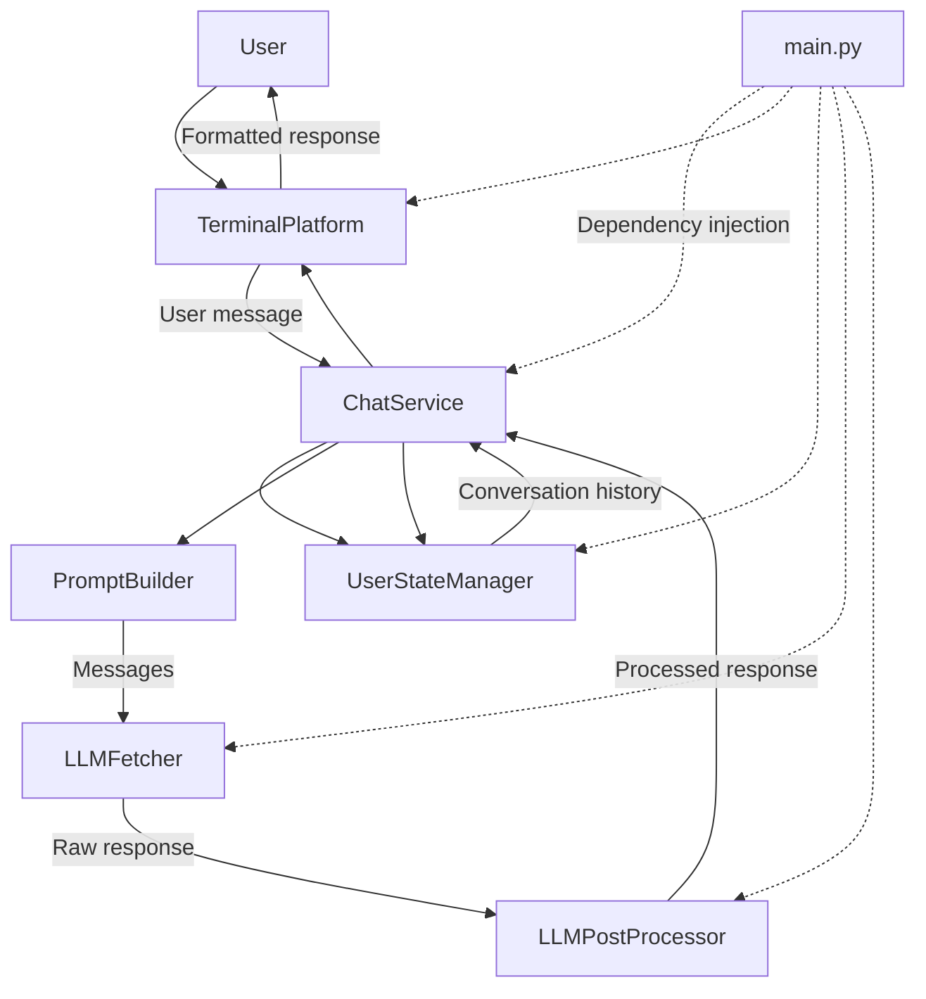

# Insurance Chatbot

A modular, terminal-based insurance assistant powered by a Large Language Model (LLM).

The application allows users to ask insurance-related questions through a command-line interface. It sends conversation history to an LLM API, processes the generated response, and maintains in-memory conversation state for the current session.

## Project Status

**Current version:** Initial development

The core conversational flow is implemented. Insurance knowledge normalization and preparation for a future Retrieval-Augmented Generation (RAG) pipeline are still under development and are not yet integrated into the chatbot's runtime.

## Architecture

The project follows a modular, layered design. The main components have separate responsibilities, making the application easier to understand, maintain, and extend.

### Project Structure

```text
ChatBot/
|-- main.py
|-- config.py
|-- normalize.py
|-- requirements.txt
|-- insurance_knowledge.md
|-- insurance_knowledge_normalized.md
`-- service/
    |-- chat_service.py
    |-- llm/
    |   |-- fetch.py
    |   |-- post_process.py
    |   `-- prompt_builder.py
    |-- platform_manager/
    |   |-- base.py
    |   `-- terminal.py
    `-- user_state/
        |-- base.py
        `-- manager.py
```

### Component Responsibilities

| Component | Responsibility |
|---|---|
| `main.py` | Creates the application components and connects them using dependency injection. |
| `config.py` | Loads environment configuration, defines the API endpoint and model, and provides the system prompt. |
| `service/chat_service.py` | Coordinates the conversation flow between the platform, LLM, and user state manager. |
| `service/llm/fetch.py` | Sends conversation messages to the LLM API and retrieves the generated response. |
| `service/llm/prompt_builder.py` | Creates the message list sent to the model by adding the current user message to the conversation history. |
| `service/llm/post_process.py` | Removes leading and trailing whitespace from the model response. |
| `service/platform_manager/` | Defines the platform interface and provides a terminal-based implementation. |
| `service/user_state/` | Defines the user state interface and stores conversation history in memory. |
| `normalize.py` | Prepares insurance knowledge text for potential future use in a RAG pipeline. |

**Note:** The insurance knowledge files and normalization script are currently under development and are not part of the active chatbot execution flow.

### Architecture Diagram



The diagram illustrates the main runtime flow. `main.py` initializes the components and injects their dependencies into `ChatService`. The service retrieves conversation history, builds the message list, requests an LLM response, processes it, stores the conversation, and returns the formatted response through the terminal platform.

## Installation and Setup

### Prerequisites

- Python 3.10 or later
- An API key for the configured LLM service
- Git

### 1. Clone the Repository

```bash
git clone https://github.com/amirmmdbatebi/ChatBot.git
cd ChatBot
```

### 2. Create a Virtual Environment

**Windows (PowerShell):**

```powershell
python -m venv .venv
.\.venv\Scripts\Activate.ps1
```

If PowerShell blocks script execution, activate the environment using Command Prompt instead:

```cmd
.venv\Scripts\activate.bat
```

### 3. Install Dependencies

```bash
python -m pip install -r requirements.txt
```

### 4. Configure Environment Variables

Create a file named `.env` in the project root directory and add your API key:

```dotenv
API_KEY=your_api_key_here
```

Replace `your_api_key_here` with your actual API key. Never commit the `.env` file or publish your API key.

The API endpoint and model are currently configured in `config.py`.

### 5. Run the Application

```bash
python main.py
```

Enter a message when prompted. To end the conversation, type `exit` or `quit`, or interrupt the program with `Ctrl+C`.

## Dependencies

- `openai` — communicates with the LLM API.
- `python-dotenv` — loads environment variables from the `.env` file.

## Current Features

- Terminal-based conversational interface.
- Integration with an LLM through an API compatible with the OpenAI Python SDK.
- Configurable model endpoint and model name.
- System prompt for insurance-related assistance.
- In-memory conversation history.
- Separate interfaces for platform management and user state management.
- Modular components connected through dependency injection.

## Current Limitations

- Conversation history is stored in memory and is lost when the application terminates.
- The application currently uses a terminal interface.
- Insurance knowledge files are not yet connected to the active conversation flow.
- Retrieval-Augmented Generation (RAG) is planned but has not yet been implemented.
- API error handling and retry behavior can be improved.
## Roadmap

- [ ] Improve API error handling and resilience.
- [ ] Refine Persian text normalization.
- [ ] Integrate insurance knowledge retrieval into the conversation flow.
- [ ] Implement a RAG pipeline for insurance-related questions.
- [ ] Add automated tests for the main components.
- [ ] Explore additional user interfaces beyond the terminal.

## Security Notes

- Keep API keys in environment variables rather than hardcoding them.
- Do not commit `.env` or other files containing secrets.
- Review changes before pushing them to a public repository.

## License

No license has been specified yet.